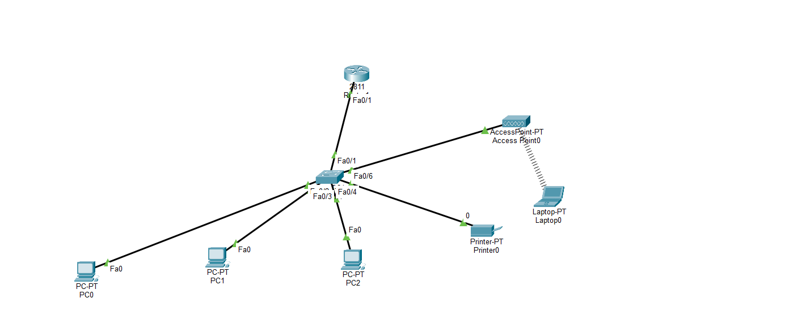
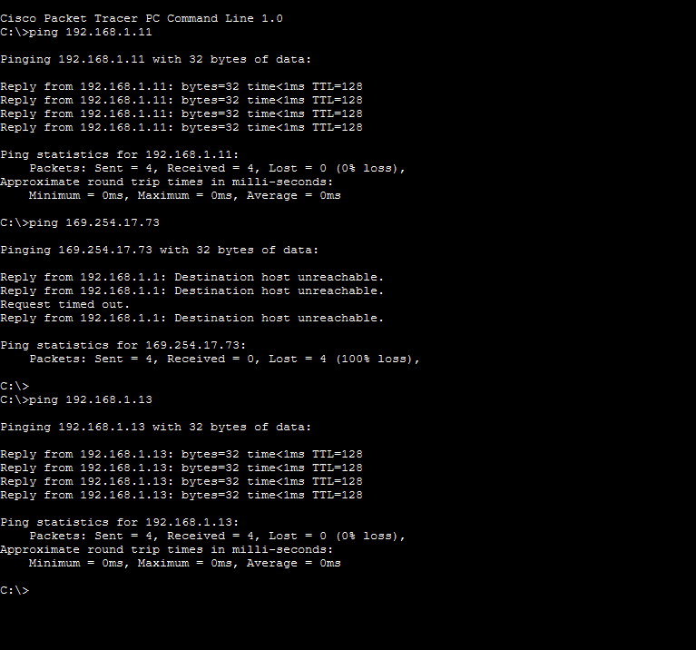

# IT Help Desk & Asset Management Lab

A practice IT support project covering ticket tracking, equipment inventory and a small office network. All names, devices and data in this project are fictional sample data.

## What is inside
- `it-help-desk-lab.xlsx`: Excel workbook with a ticket log and an equipment inventory
- `network/`: Cisco Packet Tracer network file and screenshots

## 1. Help Desk Ticket Log (Excel)
A ticket tracker for recording user problems and how they were resolved.

- Records ticket ID, date opened, user, issue, category, priority, status, solution and date closed
- Dropdown lists for category, priority and status, to keep entries consistent
- A formula that calculates the days taken to resolve each ticket
- Sample tickets cover common issues such as Wi-Fi, printer, password and software problems

## 2. Equipment Inventory (Excel)
A record of company equipment for a sample office.

- Tracks 9 sample devices (laptops, monitors, a printer, a keyboard and a phone)
- Columns: asset tag, device type, brand/model, serial number, assigned to, date issued, condition, status and department
- Shows whether each device is in use, in stock, under repair or returned

## 3. Office Network (Cisco Packet Tracer)
A small office network built and tested in Cisco Packet Tracer.

- Connected devices in a small office setup
- Tested connectivity between devices using the ping command
- Packet Tracer file: `network/office-network.pkt` (open with Cisco Packet Tracer)

### Network layout

### Successful ping test

## Skills practised
Ticket logging, spreadsheet record keeping, Excel formulas and data validation, equipment tracking, basic networking and connectivity testing
